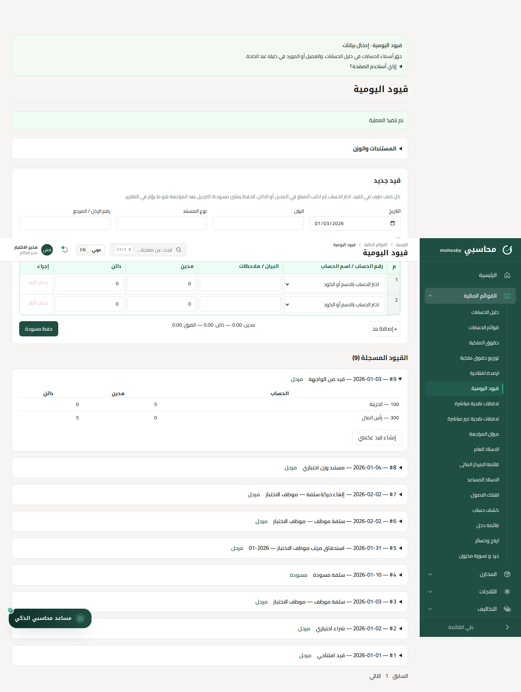
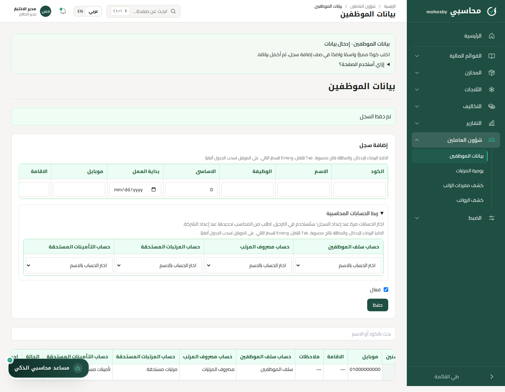
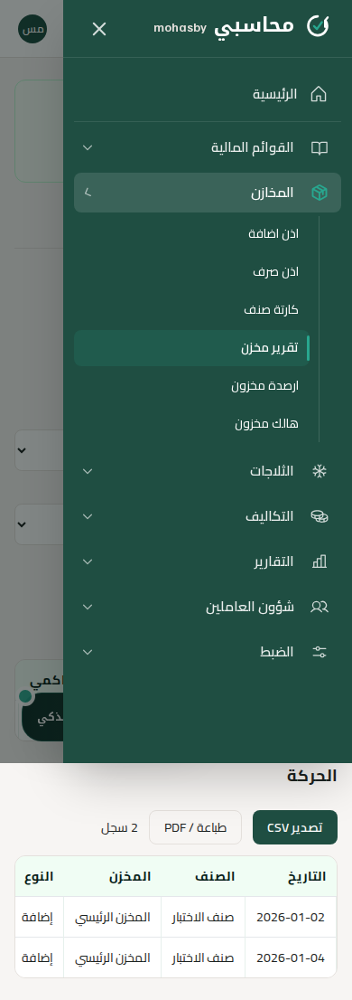
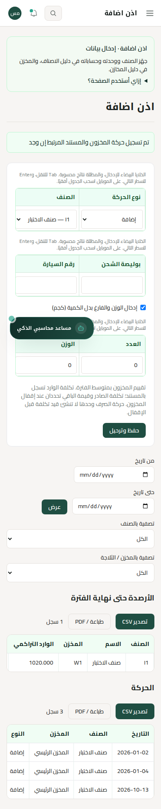

# Workbook entry and recovery update

Base: `c31e03dca425c16989bbc9481acc0755321f6eb9` (includes the existing AI assistant).
Branch: `feat/workbook-entry-ux`.

The supplied final workbook (3) is byte-identical to workbook (2). This update changes entry and report usability while keeping the established accounting formulas. No customer workbook or customer data is committed.

## Changes

- Mobile navigation supplies the Tooltip context required by its sidebar groups. Escape restores focus; the drawer contains keyboard focus and closes on navigation.
- Journal and opening balances use horizontal rows. Missing accounts, invalid amounts, and imbalance have explicit errors. Blank opposite amounts are zero. Draft entry is restored in the same tab, scoped to authenticated company and user. This is temporary browser storage, not a posted journal.
- API failures (including non-JSON proxy errors and expired sessions) stay inline. Dashboard render failures retain dashboard navigation instead of presenting every client exception as HTTP 500 or sending the user to the landing page. A successful but interrupted response still requires checking saved records before resubmitting.
- Register entry and results use separate columns. Account links are selected by name. Employee daily/hourly rates and tenure are computed columns. Customer/supplier balances are read-only with links to their account statements.
- Stock, payroll and commercial-document entry use spreadsheet rows. Stock permits add/issue logistics details and physical weight/tare entry; the server derives gross quantity and enforces a kg unit. These values persist in existing JSON metadata; no new migration is required.
- Commercial weight documents have a calculation preview before posting. The manual journal and documents/weight tool remain in the same workbook page.
- Cost and two-partner distribution inputs are editable at their table coordinates; formulas remain read-only. Farming input E117, absent from the old display-row list, is included.
- Account statements require an account selection and show opening debit/credit, current debit/credit, balance and its side. Weight-document columns follow the workbook order and read the metadata from the linked journal's document.
- All 43 Home buttons retain their names, order and targets. Every workbook page has a brief task guide. The AI reads the same page definitions and canonical links; incorrect descriptions of a cheque portfolio, user-management screen and non-existent journal buttons are removed.

## Coverage by page

| Workbook button         | Page kind    | Entry or report workflow                                                                                                                        |
| ----------------------- | ------------ | ----------------------------------------------------------------------------------------------------------------------------------------------- |
| دليل الحسابات           | إدخال        | اضغط إضافة حساب، واكتب الكود والاسم واختر الحساب الأب والتصنيف وطبيعة الحساب.                                                                   |
| قوائم الحسابات          | تقرير        | اختر الحساب الرئيسي لتصفية الدليل.                                                                                                              |
| حقوق الملكية            | تقرير        | اختَر الحساب أو الطرف أو مركز التكلفة عند ظهور هذه المرشحات.                                                                                    |
| توزيع حقوق ملكية        | مدخلات وحساب | اكتب المدخلات في الخلايا البيضاء داخل جدول التوزيع. القيم المظللة تأتي من المعادلات أو القيود.                                                  |
| تقرير المديونية         | تقرير        | اختَر الحساب أو الطرف أو مركز التكلفة عند ظهور هذه المرشحات.                                                                                    |
| دليل الاصناف            | إدخال        | اختَر الحسابات المرتبطة بالاسم من القوائم؛ لا تحتاج إلى حفظ أكواد الحسابات.                                                                     |
| دليل المخازن            | إدخال        | اختَر الحسابات المرتبطة بالاسم من القوائم؛ لا تحتاج إلى حفظ أكواد الحسابات.                                                                     |
| دليل التكاليف           | إدخال        | اختَر الحسابات المرتبطة بالاسم من القوائم؛ لا تحتاج إلى حفظ أكواد الحسابات.                                                                     |
| بيانات الموظفين         | إدخال        | اختَر الحسابات المرتبطة بالاسم من القوائم؛ لا تحتاج إلى حفظ أكواد الحسابات.                                                                     |
| ارصدة افتتاحية          | إدخال        | أدخل التاريخ والبيان، ثم اختر حساب كل صف واكتب المبلغ في مدين أو دائن. افتح الأعمدة الإضافية لتحديد الطرف ومركز التكلفة.                        |
| قيود اليومية            | إدخال        | أدخل التاريخ والبيان، ثم اختر حساب كل صف واكتب المبلغ في مدين أو دائن. افتح الأعمدة الإضافية لتحديد الطرف ومركز التكلفة.                        |
| تدفقات نقدية مباشرة     | تقرير        | اختَر الحساب أو الطرف أو مركز التكلفة عند ظهور هذه المرشحات.                                                                                    |
| تدفقات نقدية غير مباشرة | تقرير        | اختَر الحساب أو الطرف أو مركز التكلفة عند ظهور هذه المرشحات.                                                                                    |
| تقرير مراكز التكلفة     | تقرير        | اختَر الحساب أو الطرف أو مركز التكلفة عند ظهور هذه المرشحات.                                                                                    |
| اذن اضافة               | إدخال        | اكتب التاريخ ورقم الإذن، واختر الصنف والمخزن، ثم أدخل الكمية والبيان. للوارد أدخل تكلفة الوحدة والحساب المقابل.                                 |
| اذن صرف                 | إدخال        | اكتب التاريخ ورقم الإذن، واختر الصنف والمخزن، ثم أدخل الكمية والبيان. للوارد أدخل تكلفة الوحدة والحساب المقابل.                                 |
| تكاليف الاستيراد        | مدخلات وحساب | اختر المركز والفترة. أدخل القيم البيضاء في جدول التقرير؛ النتائج المظللة محسوبة.                                                                |
| يومية المرتبات          | إدخال        | اختر الموظف والتاريخ. أدخل السلف والبدلات والتأمينات بالمبلغ، والغياب والخصومات والحوافز بالأيام، والإضافي بالأيام أو الساعات كما توضح الأعمدة. |
| ميزان المراجعة          | تقرير        | اختَر الحساب أو الطرف أو مركز التكلفة عند ظهور هذه المرشحات.                                                                                    |
| الاستاذ العام           | تقرير        | اختَر الحساب أو الطرف أو مركز التكلفة عند ظهور هذه المرشحات.                                                                                    |
| قائمة المركز المالى     | تقرير        | اختَر الحساب أو الطرف أو مركز التكلفة عند ظهور هذه المرشحات.                                                                                    |
| العملاء                 | إدخال        | اختَر الحسابات المرتبطة بالاسم من القوائم؛ لا تحتاج إلى حفظ أكواد الحسابات.                                                                     |
| تقرير اليومية           | تقرير        | اختَر الحساب أو الطرف أو مركز التكلفة عند ظهور هذه المرشحات.                                                                                    |
| كارتة صنف               | تقرير        | راجع الكمية الواردة والصادرة والباقي ومتوسط التكلفة وقيمة الرصيد.                                                                               |
| تقرير مخزن              | تقرير        | راجع الكمية الواردة والصادرة والباقي ومتوسط التكلفة وقيمة الرصيد.                                                                               |
| تكاليف الزراعات         | مدخلات وحساب | اختر المركز والفترة. أدخل القيم البيضاء في جدول التقرير؛ النتائج المظللة محسوبة.                                                                |
| كشف مفردات الراتب       | تقرير        | راجع مفردات المرتب وحركات الشهر والسلف المرحلة.                                                                                                 |
| الاستاذ المساعد         | تقرير        | اختَر الحساب أو الطرف أو مركز التكلفة عند ظهور هذه المرشحات.                                                                                    |
| اهلاك الاصول            | إدخال        | اختَر الحسابات المرتبطة بالاسم من القوائم؛ لا تحتاج إلى حفظ أكواد الحسابات.                                                                     |
| كشف حساب                | تقرير        | حدد بداية ونهاية الفترة واضغط عرض. يظهر الافتتاحي والمدين والدائن والرصيد، ثم تفاصيل الحركات بنفس ترتيب كشف الشيت.                              |
| الموردين                | إدخال        | اختَر الحسابات المرتبطة بالاسم من القوائم؛ لا تحتاج إلى حفظ أكواد الحسابات.                                                                     |
| تقرير صنف ثلاجة         | تقرير        | راجع الكمية الواردة والصادرة والباقي ومتوسط التكلفة وقيمة الرصيد.                                                                               |
| ارصدة مخزون             | تقرير        | راجع الكمية الواردة والصادرة والباقي ومتوسط التكلفة وقيمة الرصيد.                                                                               |
| هالك مخزون              | إدخال        | اكتب التاريخ ورقم الإذن، واختر الصنف والمخزن، ثم أدخل الكمية والبيان. للوارد أدخل تكلفة الوحدة والحساب المقابل.                                 |
| تكاليف انتاج حيوانى     | مدخلات وحساب | اختر المركز والفترة. أدخل القيم البيضاء في جدول التقرير؛ النتائج المظللة محسوبة.                                                                |
| كشف الرواتب             | تقرير        | اختر موظفًا أو اترك كل الموظفين لمراجعة الكشف العام.                                                                                            |
| قائمة دخل               | تقرير        | اختَر الحساب أو الطرف أو مركز التكلفة عند ظهور هذه المرشحات.                                                                                    |
| ارباح وخسائر            | مدخلات وحساب | افتح مدخلات كل شريك وأدخل رأس المال والتمويل والمسحوبات والفوائد الخاصة بالفترة.                                                                |
| تقرير حركة ثلاجة        | تقرير        | راجع الكمية الواردة والصادرة والباقي ومتوسط التكلفة وقيمة الرصيد.                                                                               |
| جرد و تسوية مخزون       | إدخال        | اكتب التاريخ ورقم الإذن، واختر الصنف والمخزن، ثم أدخل الكمية والبيان. للوارد أدخل تكلفة الوحدة والحساب المقابل.                                 |
| تكاليف التصنيع          | مدخلات وحساب | اختر المركز والفترة. أدخل القيم البيضاء في جدول التقرير؛ النتائج المظللة محسوبة.                                                                |
| تقرير شامل للثلاجات     | تقرير        | راجع الكمية الواردة والصادرة والباقي ومتوسط التكلفة وقيمة الرصيد.                                                                               |
| تكاليف التصدير          | مدخلات وحساب | اختر المركز والفترة. أدخل القيم البيضاء في جدول التقرير؛ النتائج المظللة محسوبة.                                                                |

## Scope and deliberate distinctions

This is an Excel-familiar web workflow, not a literal full Excel editor: no arbitrary spreadsheet formulas, macros, bulk workbook import, or multi-cell clipboard paste is introduced. Registers define names; opening values and inventory balances are entered through their actual posting workflows, not invented editable balance cells. Ordinary journal rows with no linked weight document leave weight columns blank. Temporary draft restoration applies to journal/opening entries; other forms retain data after API errors but do not promise restoration after a browser reload.

The reported mobile error has an identifiable missing Tooltip provider in the original code. The original incomplete-journal 500 has not been proven from production logs. This patch verifies incomplete input handling and failure recovery, and tests the reported interactions; it does not claim every possible production 500 is resolved.

## Deployment

Deploy this branch on top of the final-workbook branch, not the older main branch. Keep the existing environment and PostgreSQL data. Run `npm ci`, `npx prisma generate`, `npx prisma migrate deploy`, then `npm run build` and restart the existing PM2 process. Do not reseed or reset an existing client database. No provider API key changes are needed; the current assistant provider configuration is preserved.

After deployment, verify both mobile languages: open/close the menu, navigate from it, and retry an incomplete journal. Verify a normal save/post, employee edit, a cost input, and a selected account statement. If production still errors, capture the URL, action, time, browser console and matching PM2/Nginx log excerpt with credentials and client data removed.

## Verification

Results are recorded in the pull request after running typecheck, unit tests, production build, integration tests and browser workflows. Screenshots use synthetic fixture data only. Provider-independent assistant tests cover page context, canonical links, role limits and retrieval budgets; live paid model output is not exhaustively validated.

### Local results (2026-10-13)

- TypeScript and production build: passed.
- Unit tests: 28 passed, zero failed.
- PGlite accounting integration: passed (posting/reversal, idempotency, company isolation, periodic inventory, close/carryforward and rollback).
- Production HTTP + Chromium: passed. The 43 workbook routes render their guides; Home remains 43 exact named destinations.
- Journal: missing-account and imbalance errors, restoration after reload, injected HTML 500 response without data loss, successful retry and posting.
- Employee edit persists; daily rate stays calculated from the current basic salary.
- Weight preview and ledger metadata agree: gross 900, bag loss 20, net 752.4, journal amount 752.40 for the synthetic fixture.
- Cost input saves at its worksheet coordinate.
- Mobile Arabic/English menu opens, closes with Escape, restores focus and navigates. Mobile stock entry saves metadata and derives quantity 20 from weight 25 minus tare 5; page width remains within 390 pixels.
- No uncaught browser rendering errors in the tested workflows. Assistant SSE transport was tested using the mock provider.

### Screenshots

